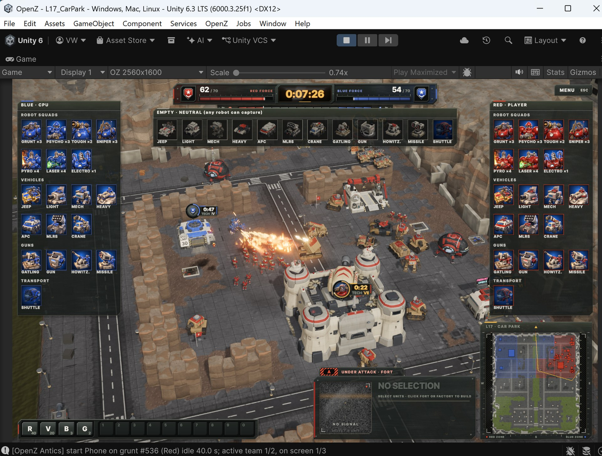
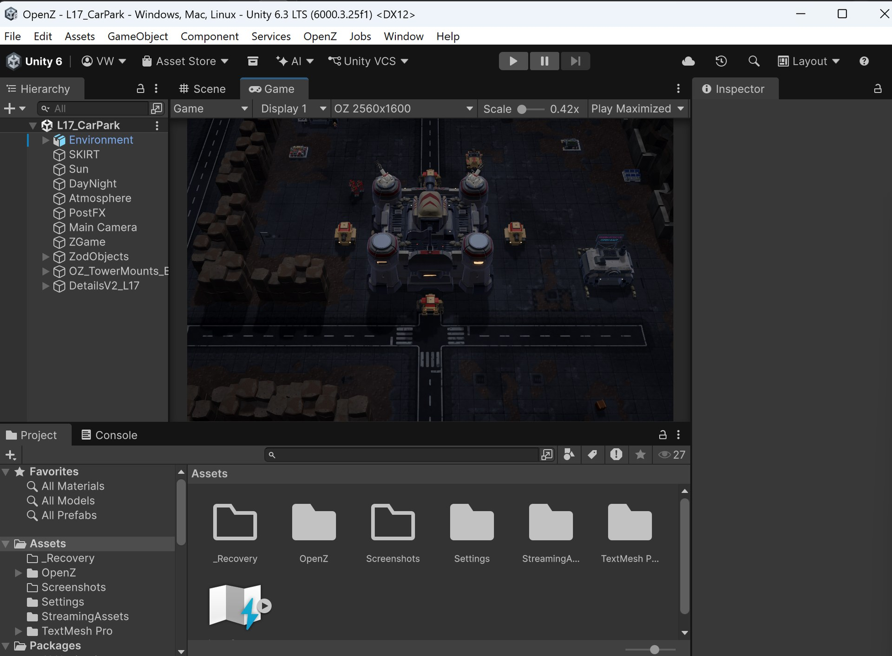
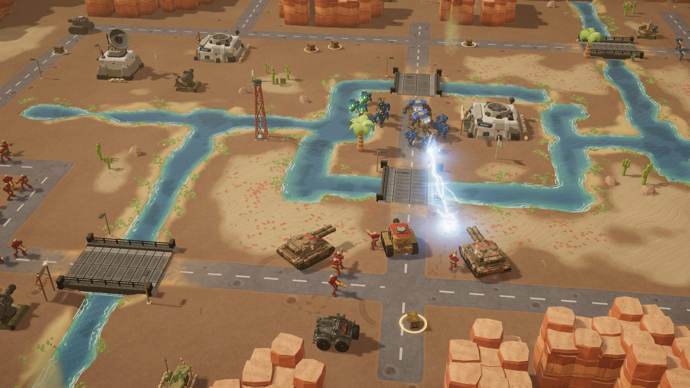
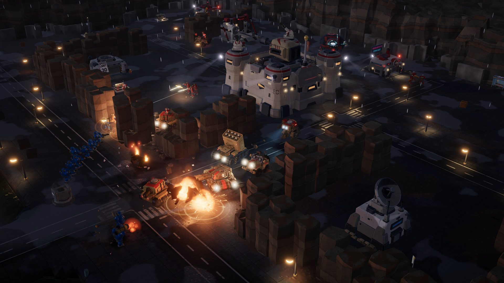
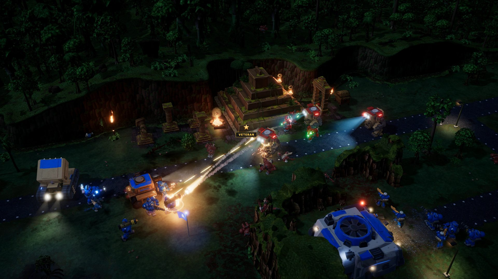
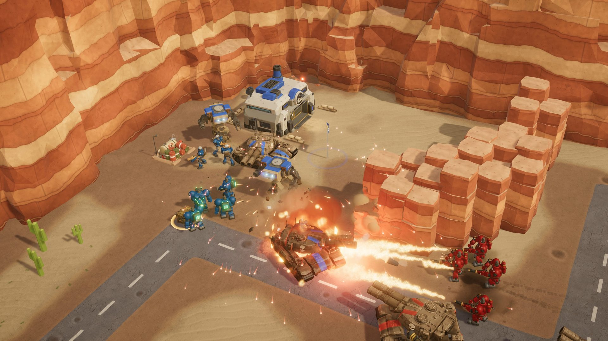
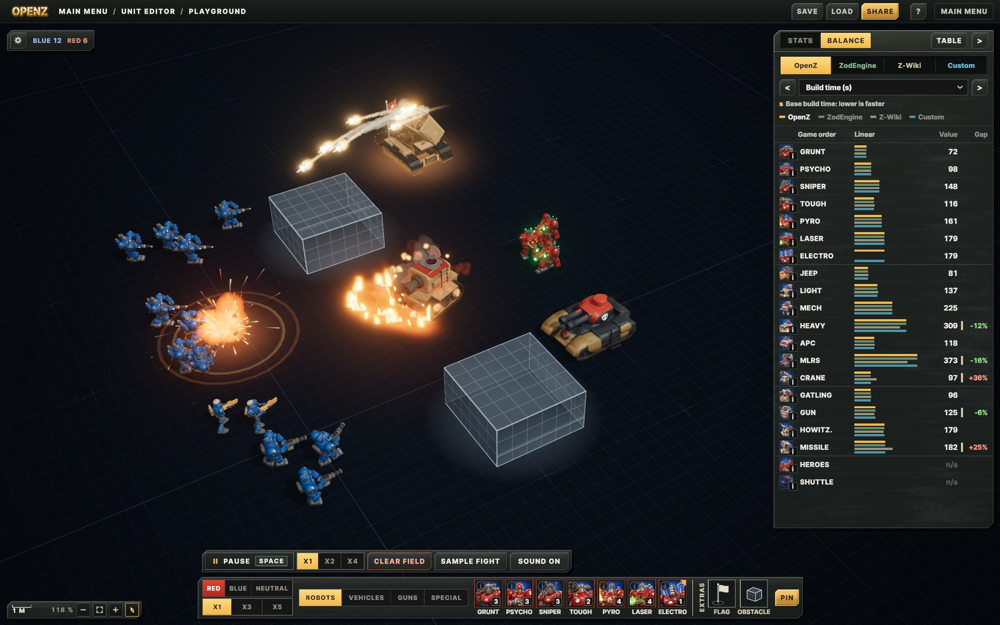
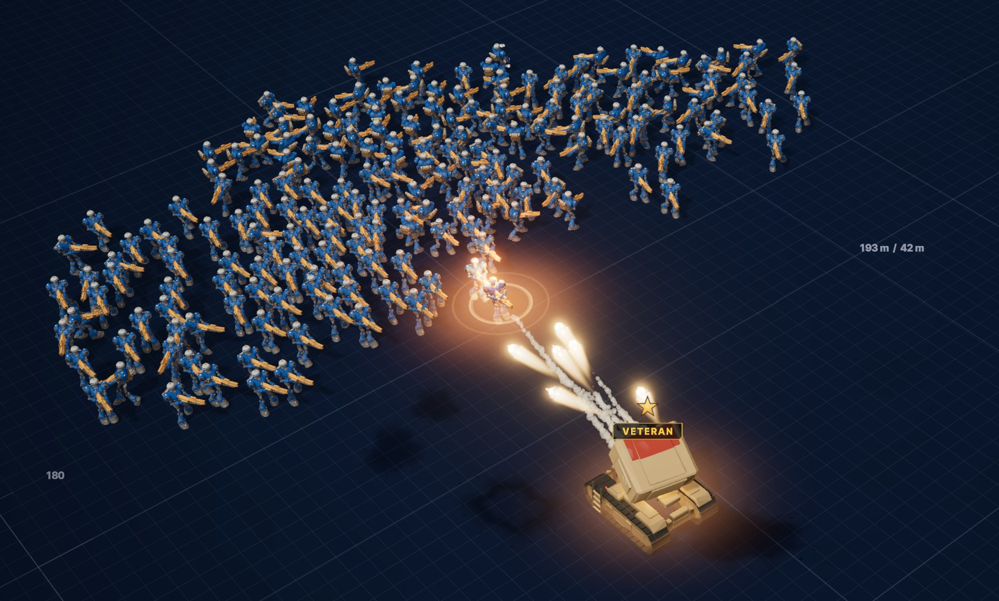

  

<h1 align="center">OpenZ</h1>

  <b>The faithful open-source 3D fan remake of Z (The Bitmap Brothers, 1996), made for its 30th anniversary.</b> 
  Free forever. Never sold. 100% original assets.

  
  
  
  
  
  
  

<h2 align="center">
  <a href="https://github.com/playopenz/OpenZ/releases/latest">Download OpenZ 1.2 for Windows (free, 3 parts, 2.1 GB)</a>
</h2>

  <a href="https://github.com/playopenz/OpenZ/releases/latest/download/OpenZ_1.2_mac_EXPERIMENTAL.tar.xz">Mac (experimental, 1.9 GB)</a> ·
  <a href="https://github.com/playopenz/OpenZ/releases/latest/download/OpenZ_1.2_linux_EXPERIMENTAL.tar.xz">Linux / Steam Deck (experimental, 1.9 GB)</a> ·
  <a href="docs/CHANGELOG.md"><b>What's new in 1.2</b></a>

  Unzip all three parts into one folder, run <code>OpenZ.exe</code>, play. No install, no account, no launcher. 
  <a href="#how-to-install">How to install</a> ·
  <a href="docs/CONTROLS.md">Controls</a> ·
  <a href="docs/SCREENSHOTS.md">Screenshots</a> ·
  <a href="https://discord.gg/WjFqg35PsE">Discord</a> ·
  <a href="https://www.youtube.com/@playopenz">YouTube</a> ·
  <a href="https://github.com/playopenz/OpenZ/issues">Bug list (GitHub Issues)</a> ·
  <a href="https://docs.google.com/forms/d/e/1FAIpQLSfMuZs9-p1pCsRm59CQy4PBuZwE8VbOAJj_2TeER6gD3sf9ag/viewform?usp=sharing">Report a bug / send an idea</a>

---

## New in 1.2

- **Play the blue side:** General EvilZod of Evil Takeover Industries, as confident as Zod, with his small, easily
  scared sidekick BS-01. Pick your general from two recruiting posters, then play every map from the blue fort, with
  EvilZod's own briefings and end scenes (the winning one involves a very big blue nuke).
- **A new medium tank** between the light and the heavy tank, and **new looks** for the heavy tank, light tank, MLRS,
  mech and gun. The mech now fires its machine gun at robots between rocket salvos.
- **Unit editor:** drop both armies onto an empty field, watch them fight and try your own unit stats, then take
  your numbers into the real levels.
- **A smarter enemy** that flies squads in shuttles to empty flags, sends damaged vehicles for repairs and guards its
  borders. Plus new voice lines, easier-to-see flags at night, the **free camera on by default**, and many fixes.
- **Experimental Linux version** (also for the Steam Deck) beside the Mac one.

Full list: [change log](docs/CHANGELOG.md).

## New in 1.1

- **Level 16: Jungle**, a third battlefield: ruins, waterfalls, wobbly rope bridges, rain, crocodiles in the swamp
  and monkeys on the temples.
- **Alan & Brad join your army** as a hero squad, and their **shuttle** is the first unit in OpenZ that flies
  (double right-click a far spot for a kickflip).
- **Sniper headshots**, **jeeps that run robots over**, **high scores and army ranks**, a smarter enemy with strike
  groups, new options, and a long list of polish and fixes on every level.
- An **experimental Mac version**.

Full list: [change log](docs/CHANGELOG.md).

## Trailer (1.1)

https://github.com/user-attachments/assets/d2f8f14e-e250-4ff4-ae1d-8252bc9c53f5

<table>
  <tr>
    <td width="50%"></td>
    <td width="50%"></td>
  </tr>
</table>

## The legendary Z is 30. This is the remake we always wanted.

Hi guys! The legendary **Z** is celebrating its 30th anniversary, and to commemorate it, the community gets the
long-awaited faithful remake of the original Z, now in **full 3D**!

Every single detail has been meticulously recreated and restored with an almost ridiculous level of attention. Every
unit, robot, vehicle, building, interaction and gameplay stat has been faithfully reproduced, and then improved with
30 years of RTS game design experience. Even the smallest elements, down to the flora and fauna of each biome, are
there.

And that's not all: several completely new ideas and brand-new content have been added, including new units like the
**Mech** and the **Electrobot**! Every change from the original is listed in the game's **Changes & Updates** screen.

<table>
  <tr>
    <td width="50%"></td>
    <td width="50%"></td>
  </tr>
  <tr>
    <td width="50%"></td>
    <td width="50%"></td>
  </tr>
</table>

## What's inside

- **Pure Z gameplay.** Capture flags to take whole territories. More territory means faster factories. Storm the enemy
  fort, or blow it to pieces. No resources to mine, no base building: just war.
- **Three classic levels, fully restored:** Level 2 (Desert), Level 16 (Jungle, new in 1.1) and Level 17
  ("Car Park"), polished to an extreme level of detail, with day, night and weather.
- **The whole robot army:** Grunts, Psychos, Snipers, Toughs, Pyros and Lasers, plus the brand-new **Electrobot**.
- **Vehicles and guns:** jeeps, light, medium and heavy tanks, APCs, missile launchers, cranes, gatlings, howitzers,
  missile cannons, and the brand-new **Mech**. Any robot can board an empty vehicle, and a sniper can shoot the driver
  out of his seat.
- **A real opponent:** the CPU is ported from the open-source Zod Engine, with Easy, Medium and Hard difficulty.
- **Everything goes boom:** buildings break apart, bridges fall, wrecks burn, crews get thrown.
- **Modern comfort:** smooth zoom from a close tactical view out to the whole map, control groups, production queues,
  rally points, rebindable keys, game speed, 4K support.
- **The humour is back:** commander Zod and his robots have plenty to say. Every character, voice and line was
  re-created from scratch for OpenZ: new designs, new models, new recordings. No original assets or materials were
  used, and any likeness to other characters or real persons is purely coincidental.

<table>
  <tr>
    <td width="50%"></td>
    <td width="50%"></td>
  </tr>
</table>

## Graphics & polish

OpenZ is built in **Unity 6** with the Universal Render Pipeline, and every model was shaped, rigged, animated and
painted in **Blender**. The goal was simple: the Z you remember, at the visual standard of a modern game, in 4K at
60 fps.

- **Living battlefields:** a full day and night cycle, rain and storms, drifting fog, wind in the flags and palms,
  heat haze over fire, lamps, searchlights and headlights that light up the night.
- **Modern rendering:** real-time shadows, anti-aliasing, bloom, motion blur, soft atmospheric lighting, animated
  water with shorelines, wet ground in the rain, and custom shaders for fire, flames, lasers and electric arcs.
- **Physics you can feel:** buildings break into pieces, bridges collapse, wrecks burn out, turrets get tossed, crews
  are thrown clear, debris bounces, shells leave craters and scorch marks, and tracks and wheels leave trails in the
  sand.
- **Animation with weight:** inverse kinematics plants every Mech foot on the ground, robots aim, kneel, go prone
  and climb into vehicles, vehicles lean and bounce, and the camera shakes when the big guns fire.
- **The little things:** flora and fauna for each biome (palms, cacti, seagulls, eagles, sandworms), base props around
  every building, team paint and war paint, rust and grime, and idle antics: leave your robots alone and they will
  find something to do.
- **Sound to match:** every action has its own sound, and commander Zod and the robots comment on the battle.

Every one of these details was recreated, restored and polished by hand, pass after pass, until it matched the
feeling of the original. This is where it started, and where it is now:

  

  

  

## Behind the scenes

OpenZ is made in **Unity**, and every model is built in **Blender**. There is no shortcut behind it: it is a long,
hard piece of work, level by level and unit by unit. Each battlefield is laid out, built, played, taken apart and
polished again, often many times over, until it feels like the Z you remember. Every unit's stats, timings, sounds and
little reactions get tested in real matches, and every bug a player reports goes onto the list and gets fixed.

<table>
  <tr>
    <td width="50%"></td>
    <td width="50%"></td>
  </tr>
</table>

## Screenshots

**From version 1.2, the free camera is on:** hold the middle mouse button and move the mouse to turn and tilt the view,
and enjoy the battlefield in full 3D from any angle, right in the game.

<table>
  <tr>
    <td width="50%"></td>
    <td width="50%"></td>
  </tr>
  <tr>
    <td width="50%"></td>
    <td width="50%"></td>
  </tr>
  <tr>
    <td width="50%"></td>
    <td width="50%"></td>
  </tr>
  <tr>
    <td width="50%"></td>
    <td width="50%"></td>
  </tr>
  <tr>
    <td width="50%"></td>
    <td width="50%"></td>
  </tr>
  <tr>
    <td width="50%"></td>
    <td width="50%"></td>
  </tr>
</table>

<b><a href="docs/SCREENSHOTS.md">More screenshots (all 76)</a></b>

## Unit editor (version 1.2 and later)

A playground for every unit in the game, opened right from the main menu. There are no factories, no fort and no
winner: drop robots, vehicles and guns of the red and blue teams onto an open battlefield, give orders to both sides,
and watch them fight. Add a neutral flag to test captures, holographic obstacles to test lines of sight and paths,
and grenade crates for your robots to pick up. Pause the fight at any moment, or speed it up.

On the right, every unit's stats sit side by side: the OpenZ values, the ZodEngine values, the values from the
Z Wiki, and your own **Custom** set that you can edit and test straight away. A balance view compares all units at
a glance. Save your setup to a file on your own disk and share it with friends, or send it to us if you find
something interesting: OpenZ itself sends nothing anywhere.

**[Read the full guide to the Unit editor](docs/UNIT_EDITOR.md)**: every button, the stat sets, custom stats, saving
and sharing, keys and tips for balance testing.

<table>
  <tr>
    <td width="50%"></td>
    <td width="50%"></td>
  </tr>
</table>

## How to install

1. **Download all three parts** from the [release page](https://github.com/playopenz/OpenZ/releases/latest): `OpenZ_1.2_win64_part1.zip`,
   `OpenZ_1.2_win64_part2.zip` and `OpenZ_1.2_win64_part3.zip` (2.1 GB together).
2. **Unzip all three into the same folder** (right click, *Extract All*).
3. **Run `OpenZ.exe`.** That's it.

> **Windows says "Windows protected your PC"?** Click **More info**, then **Run anyway**. It only appears because the
> game is not signed by a company. OpenZ sends nothing anywhere, and the full source code is right here.

**You need:** Windows 10 or 11 (64-bit), a DirectX 12 graphics card, about 3 GB of disk space.

**On a Mac (experimental):** download
[OpenZ_1.2_mac_EXPERIMENTAL.tar.xz](https://github.com/playopenz/OpenZ/releases/latest/download/OpenZ_1.2_mac_EXPERIMENTAL.tar.xz),
unpack it with Finder (double-click), then right-click the game and choose **Open** on the first start (it is not
signed). See `HOW_TO_START_ON_A_MAC.txt` inside. It is an Intel build; Apple-chip Macs run it through Rosetta.

**On Linux or a Steam Deck (experimental):** download
[OpenZ_1.2_linux_EXPERIMENTAL.tar.xz](https://github.com/playopenz/OpenZ/releases/latest/download/OpenZ_1.2_linux_EXPERIMENTAL.tar.xz), unpack it and
start `OpenZ.x86_64` (run `chmod +x OpenZ.x86_64` once if needed). On the Steam Deck use Desktop Mode, no Proton
needed. See `HOW_TO_START_ON_LINUX.txt` inside.

The Mac and Linux versions have not been tried on real machines yet: please tell us how they run.
For 1.1 there are also [community builds by fenio](https://github.com/fenio/OpenZ/releases/tag/v1.1-unofficial.1) (unofficial, native Apple Silicon + Intel Mac and Linux).

**Want to be sure your download is the original?** The checksums are in
[RELEASE_SHA256.txt](https://github.com/playopenz/OpenZ/releases/latest/download/RELEASE_SHA256.txt). Check yours in
PowerShell: `Get-FileHash OpenZ_1.2_win64_part1.zip -Algorithm SHA256`

**New to Z?** Read [how to play and all the controls](docs/CONTROLS.md), or open CONTROLS in the game's main menu.

## Watch real gameplay

Full matches, played and recorded in the game, no edits. Click a picture to watch it on YouTube; more on the
[OpenZ YouTube channel](https://www.youtube.com/@playopenz).

<table>
  <tr>
    <td width="33%" align="center"> <b>Beating the Jungle</b> (Level 16)</td>
    <td width="33%" align="center"> <b>Car Park night battle</b> (Level 17)</td>
    <td width="33%" align="center"> <b>Desert on Hard</b> (Level 2)</td>
  </tr>
</table>

## This is only the beginning

Together as a community we can bring Z back to its former glory: more restored classic levels, completely original
new levels, new units and maybe even multiplayer. **Your feedback shapes what comes next!** Play it, report every bug
you find, and tell us what you want to see. Every single report gets read.

<h3 align="center">
  <a href="https://docs.google.com/forms/d/e/1FAIpQLSfMuZs9-p1pCsRm59CQy4PBuZwE8VbOAJj_2TeER6gD3sf9ag/viewform?usp=sharing">Bug reports, feature requests and ideas: use the feedback form</a>
</h3>

Have a GitHub account? Use [**GitHub Issues**](https://github.com/playopenz/OpenZ/issues): you can see every bug that
is already reported, add a thumbs up or a comment, and follow the fix. No account? The form works just as well.
Screenshots and short clips help squash bugs much faster. We are not taking code or art contributions right now:
what we need most is players and their feedback.

**Enjoying it?** Drop a  on this page and share OpenZ with every Z fan you know!

## Source code

OpenZ is open source. The [`source`](source) folder holds the game code (C# and shaders) for reading. The **complete Unity project**
with every model, texture, sound and scene is attached to each
[release](https://github.com/playopenz/OpenZ/releases/latest) as `OpenZ_1.2_source_part1.zip` and
`OpenZ_1.2_source_part2.zip`. See [Building OpenZ from source](docs/BUILDING.md) (Unity 6.3 LTS).

## License

- **Code:** [GNU GPL-3.0](LICENSE). OpenZ ports the gameplay rules of the GPL-3.0 **Zod Engine**, huge respect to its
  creators!
- **Art, audio and all other assets:** [CC BY-NC-SA 4.0](docs/LICENSE-ASSETS.md): share and adapt them with credit, under
  the same terms, **never for commercial use**.
- OpenZ is free and will never be sold: no price, no donations, no ads, no commercial use.
- **No original materials:** nothing from the original Z game is used. No sprites, sounds, music, voices, art or logos
  were taken from it; everything in OpenZ was made new, from scratch.
- **No affiliation:** OpenZ is a faithful fan recreation built from scratch. It is not affiliated with or endorsed by
  **The Bitmap Brothers** or **Rebellion**.

Full credits: [CREDITS.md](docs/CREDITS.md).

## FAQ

**What is new in the 1.2 update?**
Choose your side, soldier! In 1.2 you can fight for **General EvilZod** and the blue army, with his small, nervous
sidekick **BS-01**, his own briefings and a very big blue nuke when you win. There is a new **medium tank**, fresh
looks for five units, a mech that fires its machine gun, a **Unit editor** to stage any battle you like, an enemy that
flies shuttles and repairs its tanks, new voice lines, the free camera on by default and an experimental Linux
version. Everything is in the [change log](docs/CHANGELOG.md).

**What was new in the 1.1 update?**
Pack your sunscreen and watch your step around the water, soldiers! 1.1 adds a whole new battlefield, **Level 16:
Jungle**, with ruins, waterfalls, wobbly rope bridges and rain. Crocodiles drag robots under in the swamp, and monkeys
flee the temples when the shooting starts. **Alan & Brad** finally join your army as a tough hero squad, straight off
their sun loungers, and their **shuttle** is the first unit that flies: carry a squad over swamps, cliffs and trees,
and double right-click a far spot for a corkscrew kickflip. On top of that: **sniper headshots**, **jeeps that run over
big robots**, **high scores and army ranks** from Private to General, Pyros that burn buildings, an enemy that sends
strike groups, new options and a huge pile of polish and fixes on every level. Everything is in the
[change log](docs/CHANGELOG.md).

**Do you have a Mac version?**
Yes, an **experimental** one: `OpenZ_1.2_mac_EXPERIMENTAL.tar.xz` on the
[release page](https://github.com/playopenz/OpenZ/releases/latest). It is an Intel build (Apple-chip Macs run it through Rosetta) and not signed, so on
the first start right-click the game and choose **Open** (see `HOW_TO_START_ON_A_MAC.txt` inside). It has not been
tried on real Macs yet, so please tell us how it runs for you.

**Is there a Linux version?**
Yes, from 1.2 an **experimental** one: `OpenZ_1.2_linux_EXPERIMENTAL.tar.xz` on the
[release page](https://github.com/playopenz/OpenZ/releases/latest), also for the Steam Deck (Desktop Mode, no Proton needed). See
`HOW_TO_START_ON_LINUX.txt` inside. Our fan **fenio** also made unofficial **OpenZ 1.1** builds for Linux and for Mac
(native Apple Silicon and Intel): [fenio's 1.1 builds](https://github.com/fenio/OpenZ/releases/tag/v1.1-unofficial.1).
Thank you, fenio! These builds are made and looked after by him, not by us.

**Running a Linux build inside a firejail sandbox and you hear sound but see no picture?** Add `protocol netlink` to
the game's firejail profile. Thanks to our player [**keelefi**](https://github.com/keelefi) for finding this and sharing
[his working firejail profile](https://gist.github.com/keelefi/3cc2adc295deef8b094cc63cc12df74e)!

**Are any original models or resources used?**
No. Everything in OpenZ was made from scratch: every model, texture, animation, sound, voice line, music track and
interface element. Nothing was taken or converted from the original game.

**Do you accept donations or plan to sell it?**
No. OpenZ is a fully non-commercial fan remake. It is free, it will never be sold, and there are no donations, ads
or paid extras of any kind.

**Does it use models or resources from Z: Steel Soldiers?**
No. Nothing from Z: Steel Soldiers is used. All models and resources were made from scratch for OpenZ.

**Is it a remake of Z: Steel Soldiers?**
No. Honestly, we were never big fans of Steel Soldiers. OpenZ is focused only on the original Z from 1996.

**What are the unit stats and game rules?**
The same as in the original game, taken from the open-source Zod Engine: unit stats, build times, territory rules
and the CPU opponent. On top of that there are some updates and improvements, and every one of them is listed in the
game's **Changes & Updates** screen.

## Disclaimer

OpenZ is an unofficial, fan-made faithful remake of Z (The Bitmap Brothers, 1996), created for its 30th anniversary.
It is **not affiliated with or endorsed by Rebellion or The Bitmap Brothers**. *Z*, its names and its characters belong
to their respective owners.

**All assets are 100% original.** No copyrighted material from the original game is used: no original sprites,
sounds, music, voice recordings, art or logos. Every model, texture, sound, voice, music track and interface element
was newly made for OpenZ.

More about the original Z: [Z Wiki](https://zzed.fandom.com/wiki/Z_%28video_game%29) ·
[ZZone fan site](https://zzone.lewe.com/) · [PCGamingWiki](https://www.pcgamingwiki.com/wiki/Z)

Contact: openzhq@gmail.com · [Discord (ZZone server)](https://discord.gg/WjFqg35PsE) · [YouTube](https://www.youtube.com/@playopenz)
